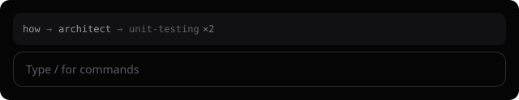
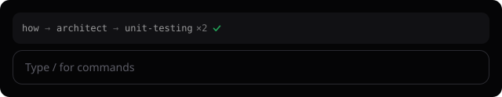
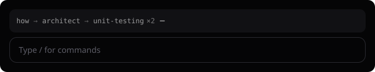
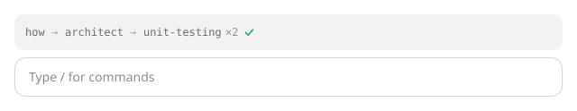
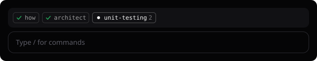
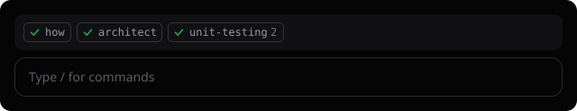
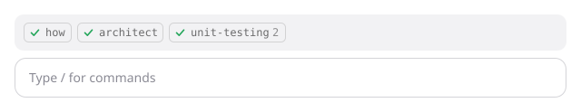

# breadcrumbs

A Claude Code mod that shows which skills ran in your last turn, as a trail
in the band above the chat input.



- Skills appear in the order they were first used, whether you typed them or
  Claude invoked them on its own.
- While the turn runs, a bright shimmer sweeps across the skill used most
  recently.
- A green check ends the trail when the turn finishes, and a dash when it was
  interrupted or failed.
- A repeated skill appears once with a count.
- The trail clears when you send your next prompt, so the band only ever shows
  the last run.
- Black text on light themes and white text on dark themes.

| Finished | Interrupted or failed |
| --- | --- |
|  |  |

On a light theme:



## Styles

Two looks are built in. Switch with a slash command; the choice is saved and
used in later sessions.

```
/breadcrumbs style trail
```

```
/breadcrumbs style tags
```

`trail` (the default) is one line of names joined by arrows. `tags` gives each
skill its own outlined tag with a dot, check or dash.

| Tags, running | Tags, finished |
| --- | --- |
|  |  |



## Animation color

By default the running animation is a bright sweep in your theme's text color.
Pick your own with a hex code, or go back to the default:

```
/breadcrumbs color #3b82f6
```

```
/breadcrumbs color default
```


The color is saved like the style. Run `/breadcrumbs` alone to see the style
and color in use.

Both styles are drawn on the desktop app. On surfaces without SVG support, such
as the terminal, the band shows it as plain text.

## Install

At the prompt of a Claude Code session:

```
/plugin install breadcrumbs --marketplace breyr/breadcrumbs
```

Answer `y` to add the marketplace, then pick a scope.

From a shell:

```bash
claude plugin install breadcrumbs --marketplace breyr/breadcrumbs
```

## Develop

Run a session with the mod loaded from your checkout:

```bash
claude --plugin-dir .
```

Run the tests and the validator:

```bash
claude plugin test .
```

```bash
claude plugin validate .
```

The trail's look lives in `hooks/trail-drawing.ts` and the tags' in
`hooks/tag-drawing.ts`; colors and sizes are constants at the top of each.

The images in `docs/` are rendered from that same drawing code, placed on a
mock of the input area. Regenerate them after changing the look:

```bash
node --experimental-strip-types scripts/render-screenshots.ts
```

## License

MIT
